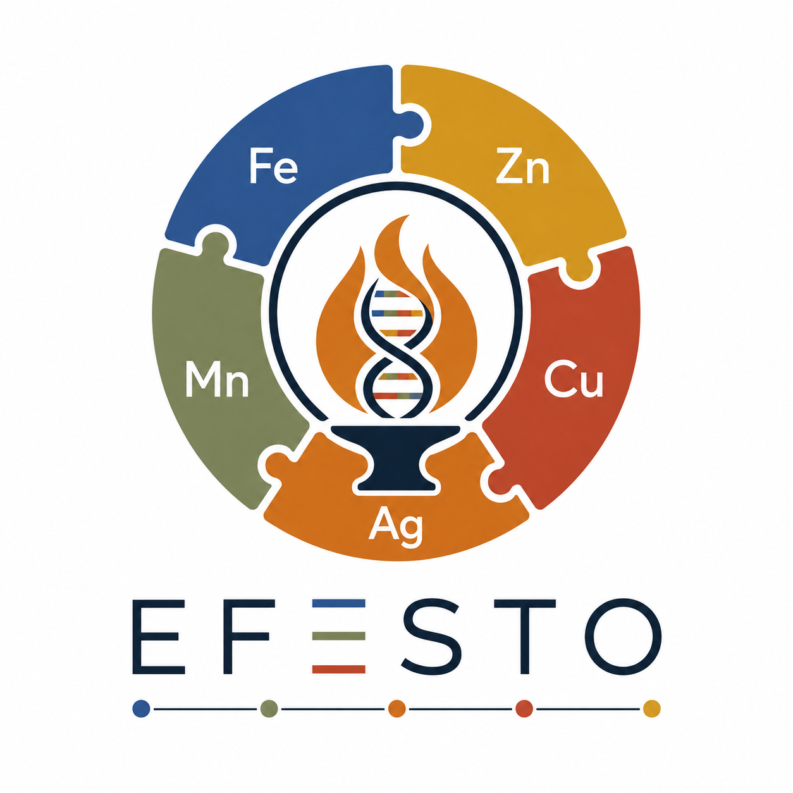

# Efesto

<p align="center"></p>

**Profile HMM annotation of metal cycling, acquisition, homeostasis and resistance genes.**

Efesto integrates profile HMMs from multiple databases and published collections
to annotate metal-related genes in genomes, metagenomes and gene catalogs. It
combines protein-family searches with genomic-context filtering and reports
optional annotation, operon, BGC, structure and topology evidence separately.

**[Documentation](https://l-gallucci.github.io/Efesto/)** ·
[Installation](docs/installation.md) · [Workflows](docs/workflows.md) ·
[Outputs](docs/output_formats.md) · [HMM library](docs/hmm_library.md)

## Install

```bash
git clone https://github.com/l-gallucci/Efesto.git
cd Efesto
mamba env create -f environment.yml
conda activate efesto
efesto --help
efesto checkenv
```

Editable installs need the checkout and its `hmm_library/`. Release wheels bundle
the library and run independently of the checkout. Optional tools and reference
databases need their own installation; see [installation](docs/installation.md).

## Run

```bash
# Genomes or MAGs, one assembly per file
efesto --fna_dir genomes/ --fna_ext fasta --meta --out efesto_out --threads 4

# Existing proteins and matching CDS coordinates
efesto --faa_dir proteins/ --gff_dir gff/ --out efesto_out --threads 4

# Gene catalog without genomic-neighbor information
efesto --faa_dir catalog/ --catalog_mode --out catalog_out --threads 4
```

The default gene caller is Pyrodigal-GV; `--gene_caller pyrodigal` selects the
alternative. Internal FAA files use Prodigal-compatible headers. Supply matching
GFF coordinates for existing proteins; arbitrary locus tags do not encode adjacency.
Use a fresh output directory after changing inputs, models or search settings.

## Results

Start with `Efesto-results-long.tsv` for retained ORFs, HMM match statistics,
threshold type and the individual annotation/context observations.
`Efesto-filter-decisions.tsv` traces retained, excluded and rescued selected HMM candidates;
`Efesto-context-evidence.tsv` describes distinct models, copies and rule outcomes;
`Efesto-confirmation-candidates.tsv` records recovered and unretained candidates;
`Efesto-UniOP-pair-evidence.tsv` contains available pair probabilities.
See the [output reference](docs/output_formats.md).

HMM thresholds, context filters and applicable eggNOG rescue decide retention.
Optional UniOP, BGC, structure and topology observations are reported separately.
Read [how the pipeline works](docs/pipeline.md) and the
[worked evidence examples](docs/evidence.md#worked-examples).

A hit indicates family-related genetic potential, not measured expression, metal
specificity, pathway activity or resistance. See [interpretation](docs/interpretation.md).

## HMM library

The library brings together profiles from **FeGenie, MetHMMDB, MnOxGeneTool,
Tabuteau et al., Pfam and NCBI protein family models**, alongside profiles built
for Efesto. Coverage includes manganese, copper, zinc, nickel, cobalt, tungsten,
lanthanides and other metal/metalloid functions, alongside iron-related processes.
Import channels, including InterPro and models obtained through other
collections, are distinguished from original providers in the source records.
See the [catalog and sources](docs/hmm_library.md#sources) and
[references](docs/references.md).

The website generates current counts from the registry. Active and experimental
profiles run by default, while deprecated profiles are skipped.
See [model scope and provenance](docs/hmm_library_curation.md).

## Integration and provenance

Shared category names and runtime tables bring the collections into one workflow;
per-model records preserve source, status and search cutoffs. Genomic grouping uses
coordinates and optional strand information. Retention decisions and optional
evidence are reported in separate tables.

FeGenie contributes imported profiles and the basis of the default context engine,
with Efesto-specific changes. Model and code provenance are documented in the
[references](docs/references.md) and [third-party notices](THIRD_PARTY_NOTICES.md).
Combining sources does not by itself establish higher annotation accuracy.
See [pipeline](docs/pipeline.md) and [performance](docs/performance.md) for filtering
and resource use.

## Scope and model changes compared with FeGenie

The [source and workflow comparison](docs/comparison.md) describes model changes relative to FeGenie,
the combined metal/metalloid scope, source contributions, imported and
Efesto-built profiles, categories, thresholds and evidence reporting.

A matched-library benchmark (**3–4 November 2026, before v1.0.0**) used
37,633 proteins and 191 original FeGenie HMMs. Efesto took **38.0 s / 562.8 MiB**
sampled peak RSS, versus **182.7 s / 886.4 MiB** for FeGenie; all 1,910 paired
HMMER tables contained identical hit rows. Each program was measured once,
including FeGenie's built-in BLAST searches and waits. These results characterize
runtime and memory for the tested configurations. See [benchmark methods and
results](docs/comparison.md#performance-comparisons).

## Cite and license

Cite Efesto using [CITATION.cff](CITATION.cff), plus the applicable model and tool
sources in [References](docs/references.md).
All Efesto-owned code, including the Python application, standalone scripts,
setup utilities and tests, is distributed under [AGPLv3](LICENSE).
Project documentation uses the same license. Third-party software and model
data retain their original terms; see [license scope](LICENSES/README.md).
Logo: [Elena Panariello](https://www.instagram.com/elena_panariello/).
Efesto is not affiliated with the original FeGenie authors.

## Source terms

Imported profiles, reference data and external tools retain their original
conditions. Each HMM is linked to its source terms in
[model_licenses.tsv](hmm_library/model_licenses.tsv); the six explicitly listed
[Efesto rebuilt profiles](hmm_library/LICENSES.md) use CC BY-SA 4.0 on
Efesto-owned contributions. Unspecified or unresolved redistribution terms
remain flagged; citation does not replace permission. See
[Third-party sources and conditions of use](THIRD_PARTY_NOTICES.md).
