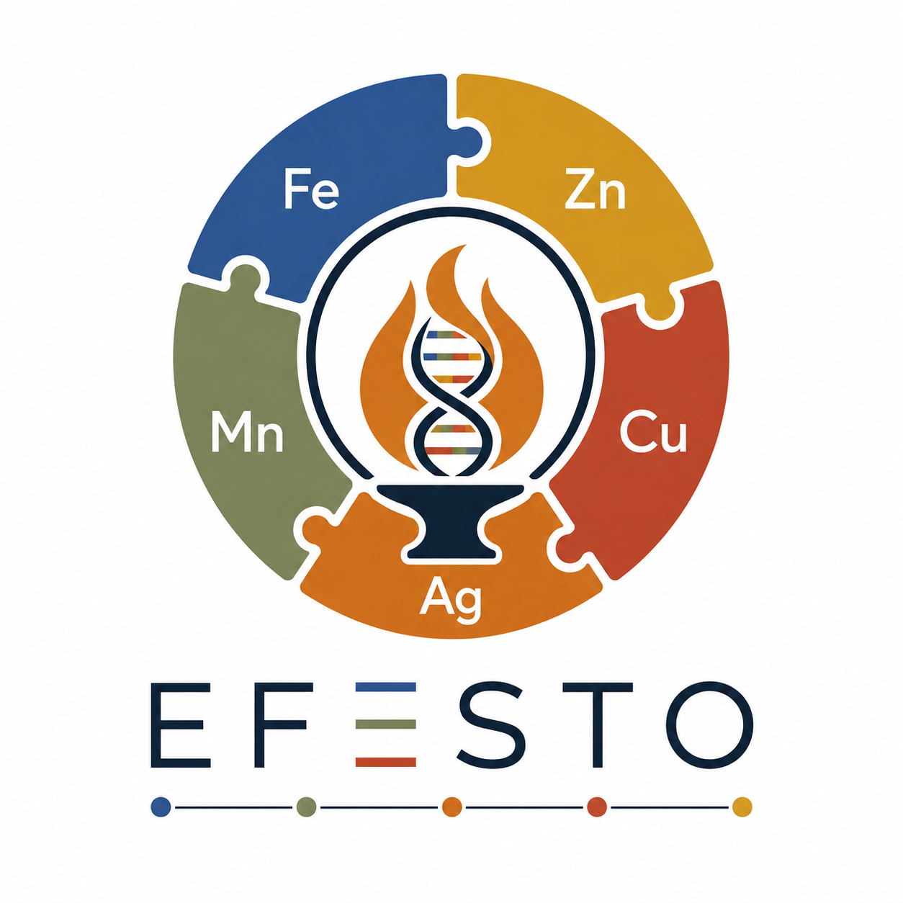

# Efesto

<p align="center"></p>

**Profile HMM annotation of metal cycling, acquisition, homeostasis and resistance genes.**

Efesto combines an expanded HMM library with genomic-context filtering and optional
UniOP, antiSMASH, eggNOG-mapper, structural and topology evidence. It builds on
[FeGenie](https://github.com/Arkadiy-Garber/FeGenie).

**[Documentation](https://l-gallucci.github.io/Efesto/)** ·
[Installation](docs/installation.md) · [Workflows](docs/workflows.md) ·
[Outputs](docs/output_formats.md) · [Development status](docs/development.md)

## Install

```bash
git clone https://github.com/l-gallucci/Efesto.git
cd Efesto
mamba env create -f environment.yml
conda activate efesto
efesto --help
efesto checkenv
```

Keep the source checkout and `hmm_library/` available. Optional tools and reference
databases need their own installation; see [installation](docs/installation.md).

## Run

```bash
# Genomes or MAGs, one assembly per file
efesto --fna_dir genomes/ --fna_ext fasta --meta --out efesto_out --threads 4

# Existing proteins and matching CDS coordinates
efesto --faa_dir proteins/ --gff_dir gff/ --out efesto_out --threads 4

# Gene catalog without genomic-neighbor information
efesto --faa_dir catalog/ --catalog_mode --out catalog_out --threads 4
```

The default gene caller is Pyrodigal-GV; `--gene_caller pyrodigal` selects the
alternative. Internal FAA files use Prodigal-compatible headers. Supply matching
GFF coordinates for existing proteins; arbitrary locus tags do not encode adjacency.
Use a fresh output directory after changing inputs, models or search settings.

## Results

Main outputs include `Efesto-results-long.tsv`, summary/count tables and matched
protein sequences. GFF3 and nucleotide matches require appropriate coordinate/source
data. See the [output reference](docs/output_formats.md).

A hit indicates family-related genetic potential, not measured expression, metal
specificity, pathway activity or resistance. Cluster confidence is a heuristic
score, not a probability. See [interpretation](docs/interpretation.md).

## Library and research status

The [catalog](docs/hmm_library.md) describes runtime categories and profile status;
the website generates current counts from the registry. Active and experimental
profiles run by default, while deprecated profiles are skipped. Unregistered
research candidates are kept outside the runtime library.

MntX, Lut/LanA and Vup classifier development is documented separately, including
small-sample and independent-validation limitations. See [development](docs/development.md)
and [validation](docs/validation.md).

## Differences from FeGenie

Efesto adds coordinate/strand-aware clustering, canonical categories, a versioned
registry, context/scoring integrations and additional output formats. HMMER searches
are coordinated by Python threads with at most two concurrent searches by default;
gene prediction has separate workers. These changes do not by themselves establish
higher annotation accuracy. See [pipeline](docs/pipeline.md) and
[performance](docs/performance.md).

## Cite and license

Cite applicable model and tool sources in [References](docs/references.md).
The code is distributed under the [MIT license](LICENSE).
Logo: [Elena Panariello](https://www.instagram.com/elena_panariello/).
Efesto is not affiliated with the original FeGenie authors.
