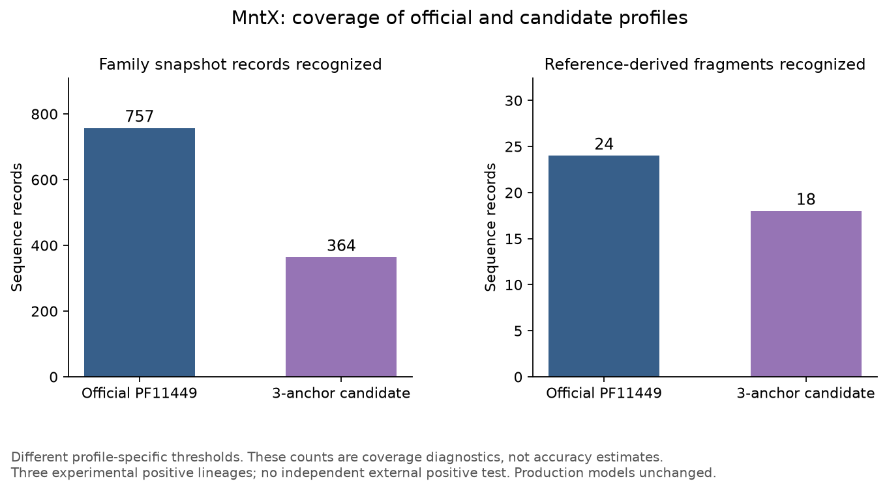

# Validation results and limits

Software tests, build reproduction, targeted sequence checks and independent
biological validation answer different questions. This page distinguishes them.

## MntX development pilot

| Check | Result |
|---|---|
| Experimental positive groups | 3: A3SI43, Q9KRF4 and AEA80752.1 |
| Targeted background controls | 133, with heterogeneous evidence |
| Grouped nested pilot | 3 outer × 2 inner folds; 3 TP, 0 FN, 0 FP, 133 TN |
| Grouping sensitivity | Same confusion counts at 70%, 80% and 90% |
| Three-positive recall uncertainty | Wilson 95% interval approximately 0.439–1.000 |
| Final development cutoff | 240.2 full-sequence bits; not a runtime cutoff |
| External positive test | Not available |

These are results on a sparse, selected panel, not population accuracy estimates.
A bootstrap over an observed zero-error sample cannot demonstrate absence of
unseen errors. Some controls are related proteins with other known annotations,
not direct experimental demonstrations of an inability to transport Mn.

The snapshot contains 757 family/reference records. At their different thresholds,
PF11449 recognizes 757 and the three-anchor candidate 364. Reference-derived
fragment diagnostics give 24/27 and 18/27. The lost matches are not demonstrated
false positives, so narrower coverage does not establish improved specificity.

[Download the figure as PDF](img/mnt_coverage_diagnostics.pdf).
The candidate has not been deployed. The official baseline also overlaps its
source seed references and is not an independent external test.

## Lut/LanA and Vup

AM1 LutH C5B163 and PA1 ABY30252.1 share 836/839 residues (99.64%). With OB3b
A0A2D2CVQ0, there are only two independent groups. LanA has one characterized
5GB1C group. Generic TonB PF00593 recognizes the four selected Ln references
and 44/45 other annotated receptors; it is not an Ln-specific ortholog classifier.

Vup components map to Ava_4040 (binding), Ava_4039 (permease) and Ava_4038 (ATPase).
Historical A/B accession labels conflict with sequence/operon evidence. A single
characterized locus is insufficient for an independent multi-locus classifier test;
its three different subunits are not three independent positives of one class.

Exploratory trees are downloadable as [MntX PDF](img/mnt_candidates.pdf) and
[Lut/LanA PDF](img/ln_references.pdf). They use selected subsets, not a placement
analysis of all retrieved homologs. See [methodology](hmm_methodology.md).

## Other panels

The official Ln/W imports and MbnA/B/C profiles have targeted reference/related-family
regression panels under `data/validation/`. Canonical references can overlap source
training. These checks establish expected behavior on those sequences, not general
sensitivity/specificity across taxa.

The software suite checks parsing, clustering, search execution and these regression
expectations. A passing software suite does not validate every model's biology.
See [source datasets](https://github.com/l-gallucci/Efesto/tree/main/data/validation)
and [curation limits](hmm_library_curation.md).
